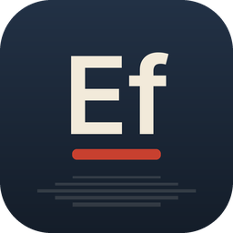
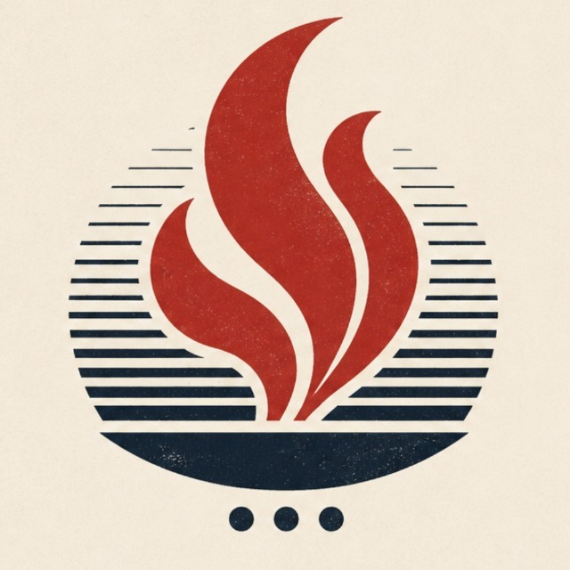

<p align="center">
  
</p>

<h1 align="center">Efeitos · Suíte FisiLab</h1>

<p align="center">
  <b>Animação gráfica e composição</b><br>
  Alternativa livre ao <b>Adobe After Effects</b>
</p>

<p align="center">
  Disponibilizado pelo <b>FisiLab — LARFIC · UFRGS</b> em parceria com o <b>CTA — Centro de
  Tecnologia Acadêmica</b>, para estudantes, professores e técnicos da UFRGS.
</p>

---

O Efeitos faz parte da **Suíte FisiLab** e é uma versão do
[EffectCraft](https://github.com/storytold/effectcraft), um compositor de código aberto para
animação gráfica e efeitos visuais escrito em Rust. Serve para títulos animados, motion graphics e
composição: você monta uma composição com camadas, anima as propriedades com quadros-chave, aplica
efeitos e renderiza o resultado.

## O que faz

- **Composições e camadas de todo tipo:** sólidos, formas, texto, vídeo e imagens, composições
  aninhadas, nulos, camadas de ajuste, câmeras e luzes; parentesco, track mattes, 38 modos de
  mesclagem e desfoque de movimento.
- **Quadros-chave como no After Effects:** interpolação linear, Bézier e de retenção, Easy Ease,
  diálogos de velocidade e interpolação, e um **Editor de Gráficos** com curvas de valor e de
  velocidade.
- **Formas, máscaras e texto:** camadas de forma com trim paths, repetidores e caminhos de mesclagem;
  máscaras desenhadas com a caneta; texto com as fontes instaladas no computador e animadores de
  texto.
- **Mais de 300 efeitos** (desfoque, correção de cor, distorção, geração, chroma key, partículas e
  simulações, estilização, tempo, áudio, transições) e os nove **Estilos de Camada**.
- **Expressões em JavaScript** com o modelo de objetos do After Effects (`wiggle`, `loopOut`,
  `thisComp.layer("…")`) e scripts no estilo ExtendScript.
- **3D clássico:** camadas 3D, câmeras com profundidade de campo e luzes com sombras suaves.
- **Fila de renderização:** H.264 e HEVC (MP4), ProRes (MOV), AV1, WebM, sequências PNG/JPEG/TIFF/EXR,
  GIF animado e WAV/AIFF, tudo em Rust puro, sem FFmpeg; importação e exportação de **Lottie**.
- **Projetos legíveis** (`.ecproj`, JSON versionado), linha de comando (`fisilab-efeitos-cli`) e
  servidor MCP para automação.

## Instalação

### Windows

Baixe o instalador `FisiLab-Efeitos-Setup-<versão>.exe` no portal de downloads da
[Suíte FisiLab](https://github.com/mrcandrade/larfic/tree/main/suite-fisilab) ou na página de
[Releases](https://github.com/mrcandrade/fisilab-efeitos/releases) do repositório
`mrcandrade/fisilab-efeitos` e execute-o.

### Compilar a partir do código

É preciso ter o [Rust](https://rustup.rs/) 1.95 ou mais recente.

```sh
git clone https://github.com/mrcandrade/fisilab-efeitos
cd fisilab-efeitos
cargo run --release -p effectcraft            # o aplicativo (fisilab-efeitos.exe); `-- --demo` abre o projeto de demonstração
cargo run --release -p effectcraft-cli -- --help   # a linha de comando (fisilab-efeitos-cli.exe)
```

Os pacotes Rust mantêm os nomes do projeto original (`effectcraft`, `effectcraft-cli`); os
executáveis gerados se chamam `fisilab-efeitos` e `fisilab-efeitos-cli`.

## Créditos

O Efeitos é baseado no **[EffectCraft](https://github.com/storytold/effectcraft)**, criado pelo
**ArtCraft Team e contribuidores** e distribuído sob a licença MIT ou Apache 2.0, à sua escolha
([LICENSE-MIT](LICENSE-MIT), [LICENSE-APACHE](LICENSE-APACHE)). Todo o trabalho de edição, efeitos,
formatos de arquivo e ferramentas é deles: muito obrigado!

O FisiLab alterou o nome, a identidade visual, o tema de cores, a tela de abertura, os links e o
instalador; a lista completa está em [MODIFICACOES.md](MODIFICACOES.md). Veja também
[NOTICE](NOTICE), [ATTRIBUTION.md](ATTRIBUTION.md) (material de terceiros) e o
[README original](README.upstream.md).

Os nomes e marcas do projeto original pertencem aos seus titulares. Esta versão não é afiliada nem
endossada por eles.

## Manifesto

Conhecimento produzido numa universidade pública deve circular livremente, e as ferramentas que
usamos para ensinar, pesquisar e criar também: leia o
[Manifesto pelas tecnologias livres](https://github.com/mrcandrade/larfic/blob/main/suite-fisilab/MANIFESTO.md).

---

<p align="center">
  <a href="https://www.ufrgs.br"></a>
  &nbsp;&nbsp;
  <a href="https://cta.if.ufrgs.br"></a>
  &nbsp;&nbsp;
  
</p>

<p align="center">
  <sub>Suíte FisiLab · FisiLab — LARFIC · UFRGS · em parceria com o CTA — Centro de Tecnologia Acadêmica</sub>
</p>
